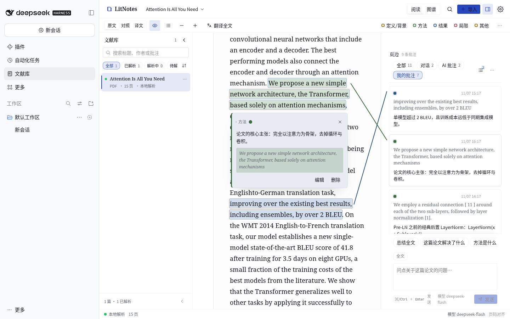
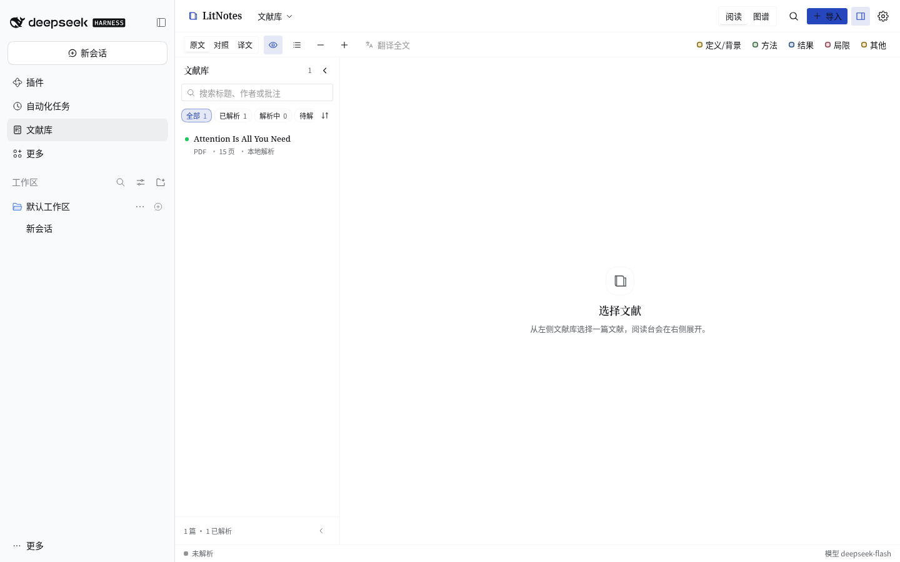
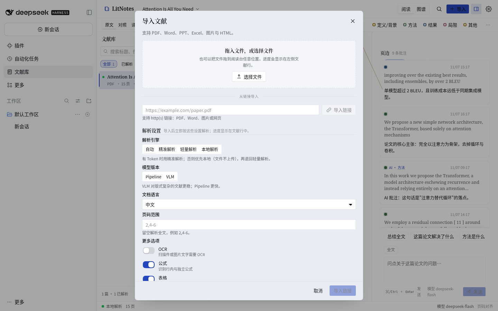
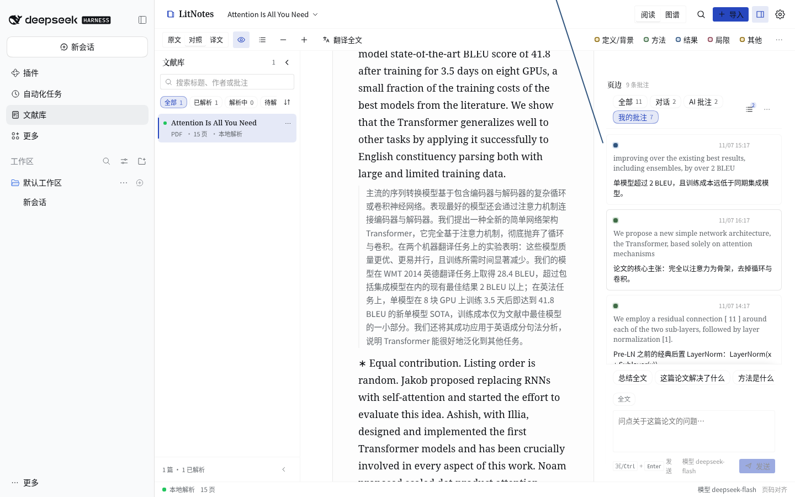
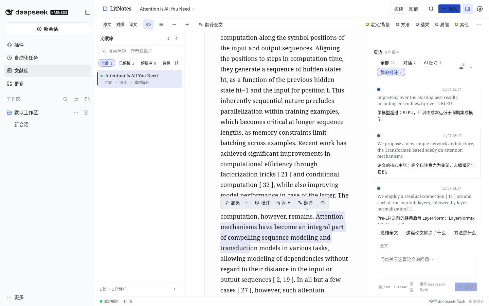
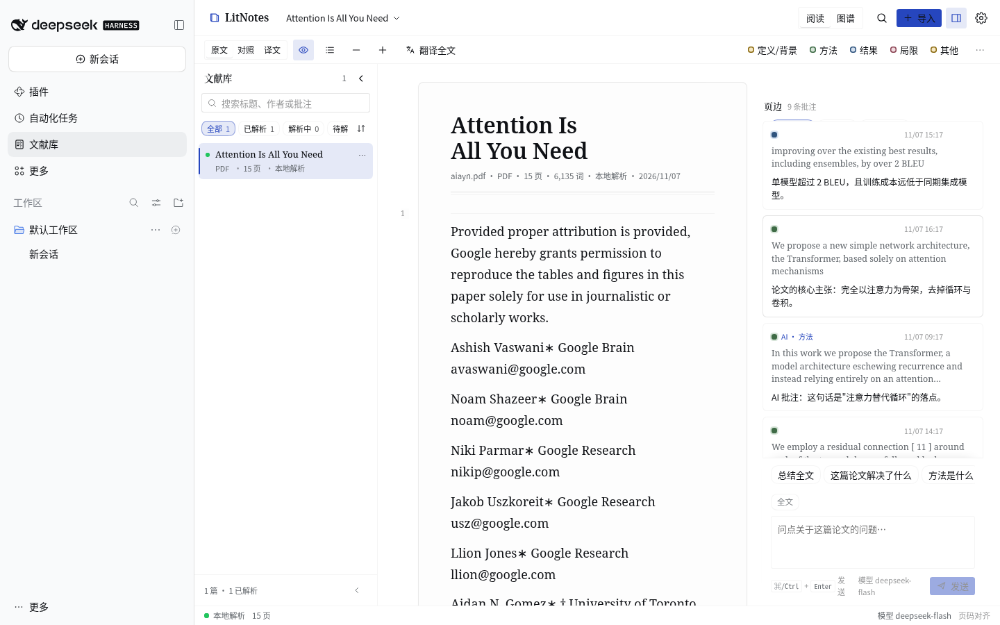
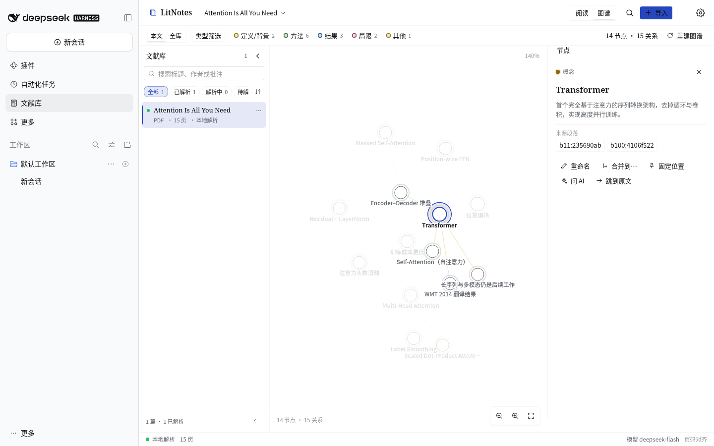
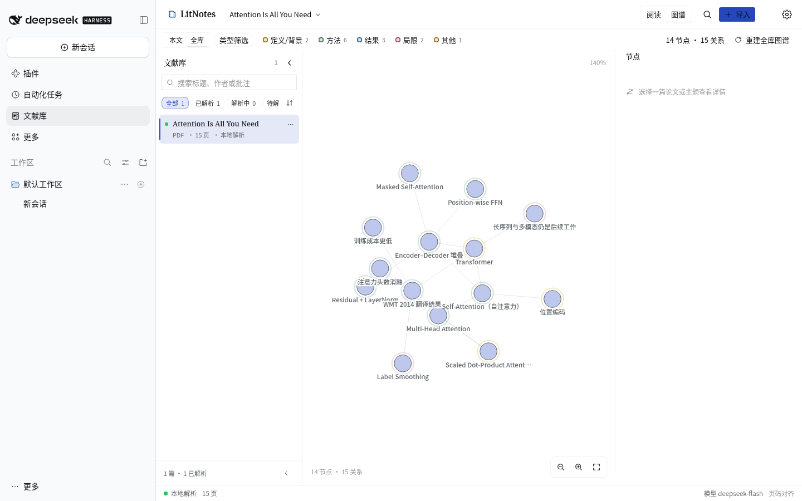
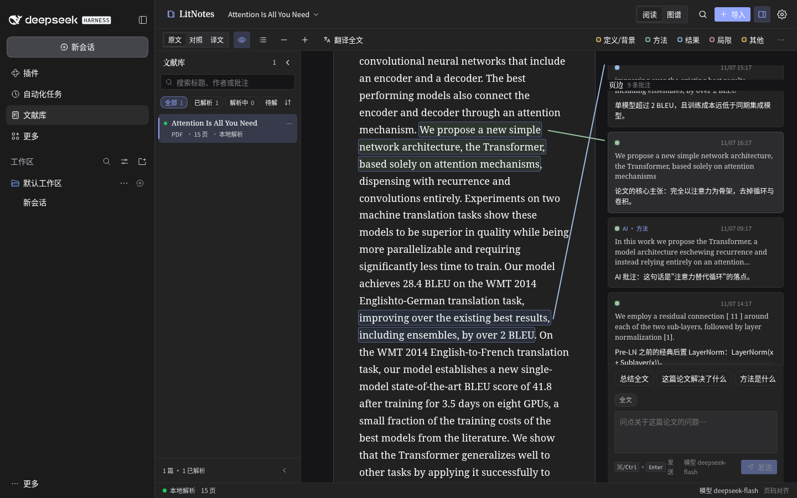
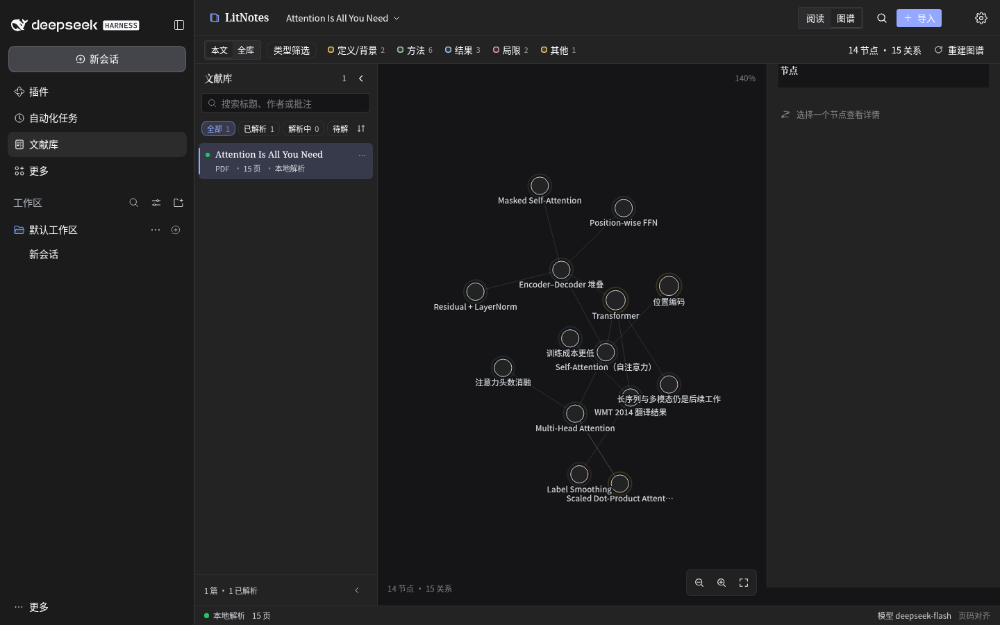

# dsh-litnotes · The Margin Desk

> **Put the AI in the margin, not in another window.**

A local-first AI literature desk that plugs into the [DeepSeek Harness](https://github.com/deepseek-ai/deepseek-harness) Web UI: a paper library, bilingual reading, annotations and AI conversation that sit on the page, and a knowledge graph grown out of your papers.

<sub>[**English**](README.md) · [简体中文](README.zh.md)</sub>

[](CHANGELOG.md)
[](tsconfig.json)
[](package.json)
[](#data-and-privacy)



<sub>Every screenshot was captured from the plugin running for real; the sample paper is *Attention Is All You Need*, parsed by the local engine with no upload.</sub>

---

## Why the margin

Most AI reading tools put the conversation in a floating window: ask a question, switch back to the text, hunt for the quote — attention split in two. dsh-litnotes answers differently: **AI belongs in the margin, just as annotations always have.**

- **Your eyes never leave the page.** The paper and the margin are two independent reading surfaces — scrolling one never drags the other. Annotations and AI answers are pinned to their place in the text, and a 1px tether ties each margin entry back to its sentence. Hover either end and the other lights up.
- **Evidence before conclusions.** Every answer carries `[n]` citations: hover to preview the quoted sentence, click to jump back to it. Quotes are validated verbatim, then checked again for whether they actually support the claim; unverified citations never become annotations.
- **Order is position.** Margin entries are ordered by where they sit in the text. Read the margin top to bottom, and you read the paper front to back.

## At a glance

| | |
| --- | --- |
| **Library** — parse status, progress, filters and full-text search<br> | **Import and parse** — drop, pick a file or paste a link; three parse engines<br> |
| **Reading desk** — four aspect inks, margin notes, click a highlight for its annotation card<br> | **Bilingual reading** — original and translation, paragraph by paragraph<br> |
| **Select to act** — highlight, annotate, ask AI, translate, copy<br> | **AI in the margin** — citations jump to the source, follow-ups, export<br> |
| **Per-paper knowledge graph** — the concepts, methods and findings inside one paper<br> | **Library graph** — every paper aggregated into topics<br> |
| **Dark mode · reading**<br> | **Dark mode · graph**<br> |

## Features

### Reading

- Original, bilingual and translation-only modes; the text column uses the full paper width by
  default, with adjustable scale, page marks and outline; formulas rendered locally with KaTeX,
  figures and tables kept in page order.
- Reading position, mode and panel widths are persisted locally — reopening a paper returns to where you left off.
- The margin can show only your notes or only AI annotations, and can be filtered by aspect.

### Annotations and the margin

- Four aspects — definition/background, method, result, limitation/context — each with its own ink. Highlights, margin notes and AI annotations live in the same column.
- Click a highlight to open its annotation card: the note, the quoted source, and **edit / delete** actions.
- After a re-parse, annotations are re-anchored by their verbatim quote; ones that cannot be re-anchored are flagged as stale instead of being silently dropped.

### Grounded AI conversation

- Answers are generated only from the current paper's parsed text and streamed; stop, regenerate and follow-up questions are supported.
- Citations are validated before they are shown; unverified citations are dimmed and never become annotations. A citation in an answer jumps straight back to its sentence.
- Verified citations become AI annotations in their aspect color, carrying model and conversation provenance.
- Preset questions sit right above the composer in every scope, and the composer can be
  answered by typing, by a preset, or by a follow-up.
- Questions default to the **whole paper** (no paragraph is attached for you); the per-paragraph
  **Ask AI about this paragraph** button next to translate/annotate narrows the focus to one
  paragraph, and a text selection narrows it to the selection — the composer chip always shows
  which scope is active.
- Conversation history is stored per paper locally, can be cleared and exported as Markdown.

### Knowledge graphs

- **Per-paper graph**: one action reads the paper and extracts concepts, methods, findings, definitions, limitations and sections plus their relations. Nodes keep their source location and jump into the text, and Q&A keeps adding new nodes over time.
- **Library graph**: all papers are aggregated deterministically into topic clusters and shared-concept relations, and can be rebuilt at any time.
- The canvas supports panning, cursor-anchored zoom and drag-to-pin; nodes can be renamed, merged and pinned, and manual edits survive a rebuild.

### Library and parsing

- The library keeps parse status and progress, with search, type filters and sorting; import by drag and drop or by URL.
- Three parse engines: MinerU precise parsing (configured token), MinerU lightweight cloud parsing (no token), and a local engine (no upload, pdf.js text extraction).
- An async parse queue with cancel, failure reasons, restart resume and **page-scoped repair** — only the broken pages are re-parsed and spliced back, leaving other pages and annotations untouched.

### Agent-native

dsh-litnotes is a DSH plugin, and it gives the same library to agents: seven tools, one coordinate system, plus a static system-prompt section that tells the agent when to use them.

| tool | purpose |
| --- | --- |
| `library_search` | search passages across the library or one paper; returns `documentId/blockKey/page/snippet` |
| `library_read` | metadata and outline, bounded markdown slices, exact block text, or a whole page |
| `library_ask` | grounded answer with citation coordinates (and auto-created AI annotations) |
| `library_annotate` | list / create / update / delete highlights and margin notes |
| `library_translate` | translate arbitrary text, or up to 10 cited blocks |
| `library_graph` | read/search/build/update a paper graph; read/rebuild the library graph |
| `library_manage` | list/status/URL import/parse/page repair/cancel/rename/delete |

## Getting started

### Install

Install this repository into the DSH Web profile through the plugin manager (for a checkout in development, point `link:` at the directory):

```
plugin_manager install_bundle link:/path/to/dsh-litnotes
```

Or with the CLI:

```bash
dsh plugin --profile web add link:/path/to/dsh-litnotes
```

Reload the Web UI afterwards. Prerequisites: a DSH Web profile that mounts `webServer` and `connection`. Optional services light up the matching features: `llm` (AI), `credentials` (persistent MinerU token), `translator` (translation), `officeToPdf` (local Office conversion), `tokenMeter` (context budgeting), `systemPrompt` (agent hint) and `tools` (agent tools).

### First run

1. Open the **LitNotes library** panel in the sidebar, then drop or pick a PDF, or paste a link.
2. Choose how to parse. The default `auto` engine uses precise parsing when a MinerU token is configured; otherwise it prefers the local engine (the file is never uploaded) and falls back to the token-free lightweight cloud parser for formats local parsing cannot handle.
3. Open the parsed paper: read it, compare translations, highlight and annotate — or ask the AI from the margin composer.
4. Switch between **Read** and **Graph** at the top; within the graph, switch between **This paper** and **Library**.
5. Ask an agent in DSH chat to "search / read / annotate the library" — it uses the same data and the same coordinates.

## Data and privacy

```
~/.dsh/litnotes/                        (or $DSH_HOME/litnotes)
  documents/<id>/source.<ext>           original file
  documents/<id>/parsed/                full.md, content_list.json, images
  documents/<id>/annotations.json       highlights and margin notes (with AI provenance)
  documents/<id>/translations.json      paragraph translation cache
  documents/<id>/chat.json              grounded conversation history
  documents/<id>/graph.json             per-paper knowledge graph
  library-graph.json                    library-wide knowledge graph
  preferences.json                      reading and AI preferences
```

- Files, parse results, annotations, conversations and graphs stay on this machine. Only an explicit cloud parse uploads the source file to MinerU.
- AI questions send only the bounded retrieved context (the relevant passages), never the whole library.
- The MinerU token lives in the DSH credential store and is never returned to the browser or written to logs.

## Compatibility

- On-disk JSON uses stable version-1 envelopes and is compatible with the pre-refactor 0.3.0 format: an existing library loads **without migration**.
- The plugin package has **zero runtime npm dependencies**; the only external requests the client bundle makes are for the platform-provided React modules.
- The source is strict TypeScript (`strict`, `noUncheckedIndexedAccess`, `verbatimModuleSyntax`, no `any`); the host and client halves speak one typed wire contract.

## Development

```bash
pnpm install                      # dev dependencies only
node scripts/build.ts             # build Host index.js and Client lib/client.js
pnpm typecheck                    # strict type-check
pnpm test                         # vitest (790 tests)
node scripts/check.ts             # 17-check release gate
node scripts/check.ts --final     # release gate (warnings are failures)
```

Requires Node ≥ 20.16. Source lives in `src/shared/**` (both halves), `src/host/**` and `src/client/**`; `index.js` and `lib/client.js` are build artifacts.

## Docs

| document | contents |
| --- | --- |
| [`docs/ARCH.md`](docs/ARCH.md) | architecture, data formats, HTTP wire contract, build and gate |
| [`docs/PARSING.md`](docs/PARSING.md) | parse engines, page-scoped repair, annotation re-anchoring |
| [`docs/AGENT.md`](docs/AGENT.md) | the seven agent tools with a worked flow |
| [`docs/AI-SPEC.md`](docs/AI-SPEC.md) | grounded chat, citation validation, entailment, knowledge graphs |
| [`docs/UI-SPEC.md`](docs/UI-SPEC.md) | reading-desk design system and interaction contract |
| [`CHANGELOG.md`](CHANGELOG.md) | release history |

---

Built as a [DeepSeek Harness](https://github.com/deepseek-ai/deepseek-harness) plugin.

[](https://github.com/deepseek-ai/deepseek-harness)
