# dsh-litnotes · 页边阅读台

> **把 AI 放进页边，而不是放进另一个窗口。**

一个本地优先的 AI 文献阅读台，以插件形式装进 [DeepSeek Harness](https://github.com/deepseek-ai/deepseek-harness) Web UI：论文库、双语阅读、贴着原文的批注与 AI 对话，以及从论文里长出来的知识图谱。

<sub>[English](README.md) · **简体中文**</sub>

[](CHANGELOG.md)
[](https://www.npmjs.com/package/dsh-litnotes)
[](https://github.com/NIRVANA-APOC/dsh-litnotes/actions/workflows/ci.yml)
[](tsconfig.json)
[](package.json)
[](#数据与隐私)


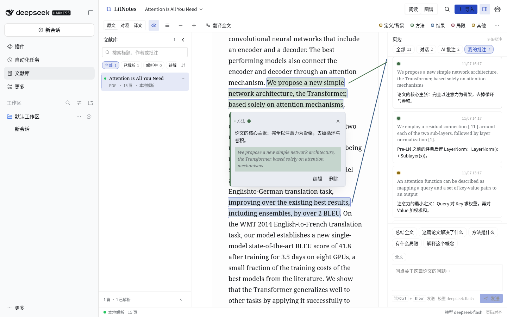

<sub>截图全部来自真实运行的插件；样例论文为《Attention Is All You Need》（本地引擎解析，无云端上传）。</sub>

---

## 为什么是"页边"

大多数 AI 阅读工具把对话塞进一个悬浮窗口：提问、切回正文、找引用——注意力被切成两半。dsh-litnotes 的回答是：**AI 属于页边，就像批注一直属于页边一样。**

- **眼睛不离正文。** 论文与页边是两条独立的阅读滚动区——滚动一侧不会拖动另一侧。批注和 AI 回答钉在原文位置，一条 1px 牵引线（tether）把页边条目连回它所在的那句话。悬停任一端，另一端同时亮起。
- **结论之前先给证据。** 每条 AI 回答都带 `[n]` 引用：悬停预览原句、点击跳回原文。引用先被逐字校验，再做一遍"引用是否真的支撑结论"的蕴含检查；未证实的引用不会变成批注。
- **顺序就是位置。** 页边条目按它们在正文中的位置排列，从上到下读，就是从头到尾读。

## 一眼看完

| | |
| --- | --- |
| **文献库**：解析状态、进度、筛选与全文检索<br>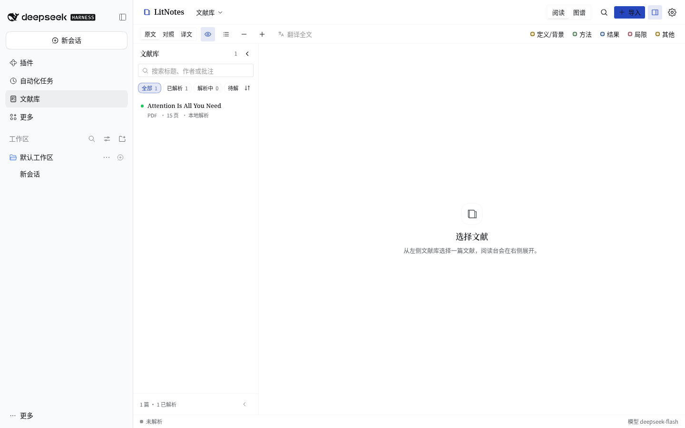 | **导入与解析**：拖拽 / 文件 / 链接，三种解析引擎<br>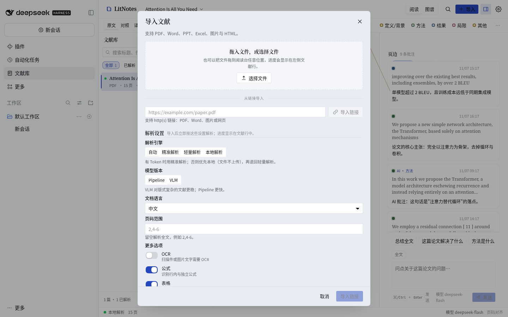 |
| **阅读台**：侧重点四色高亮、页边笔记、点按高亮弹出批注卡<br> | **对照阅读**：原文与译文对照，逐段翻译<br>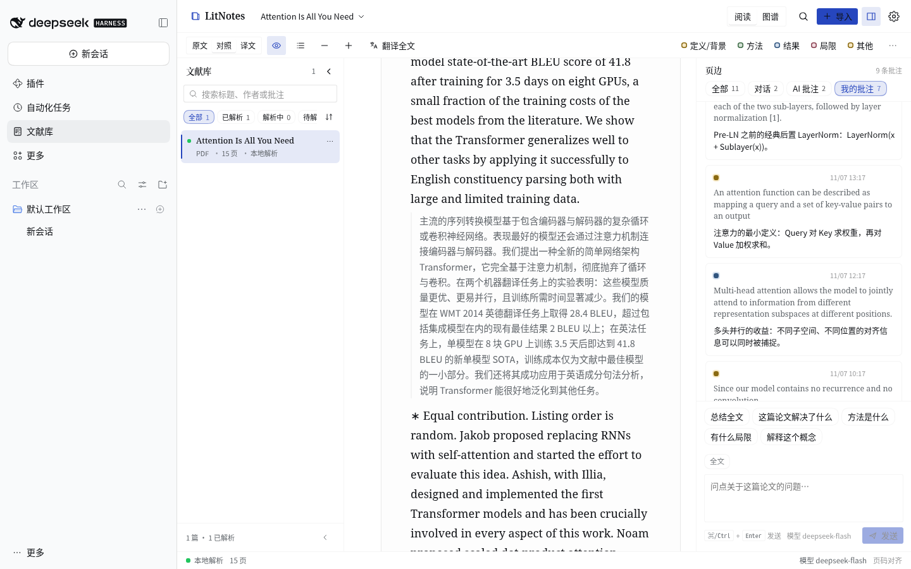 |
| **选中即问**：高亮、批注、问 AI、翻译、复制<br>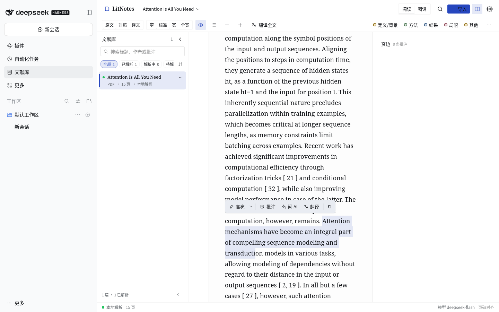 | **AI 在页边回答**：引用可跳转、可追问、可导出<br>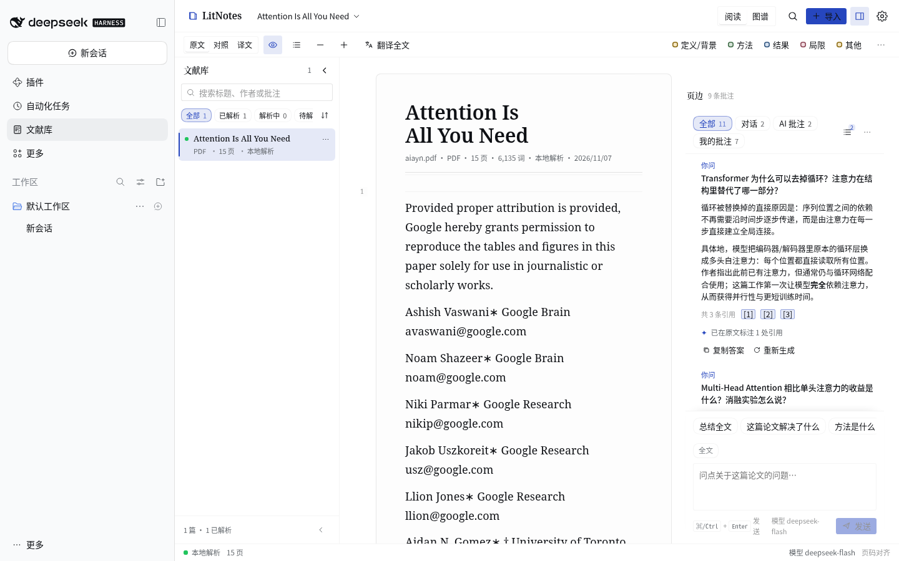 |
| **本文知识图谱**：论文里的概念、方法与发现<br>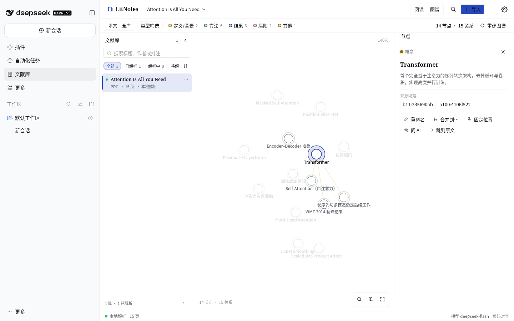 | **全库图谱**：所有论文按主题聚类汇总<br>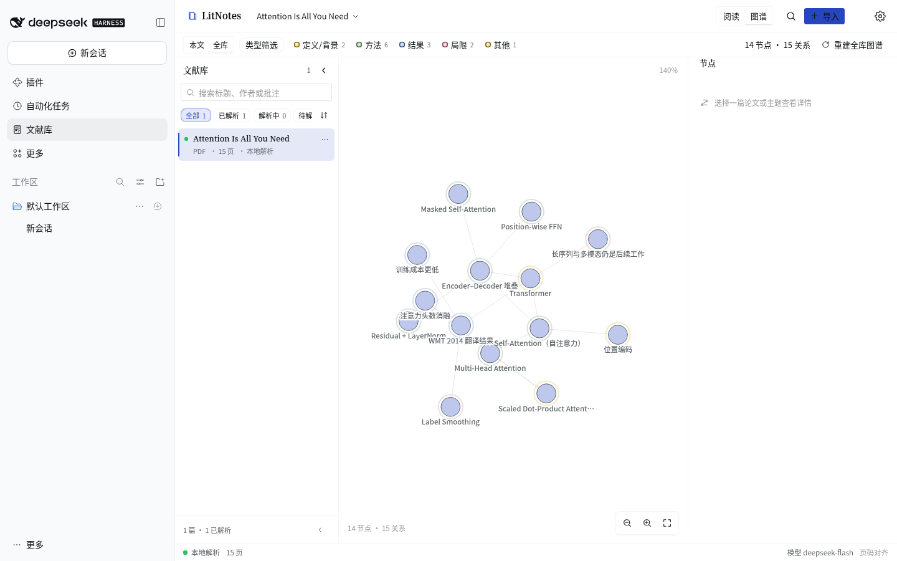 |
| **AI 精读**：通读全文生成可跳转的精读报告<br>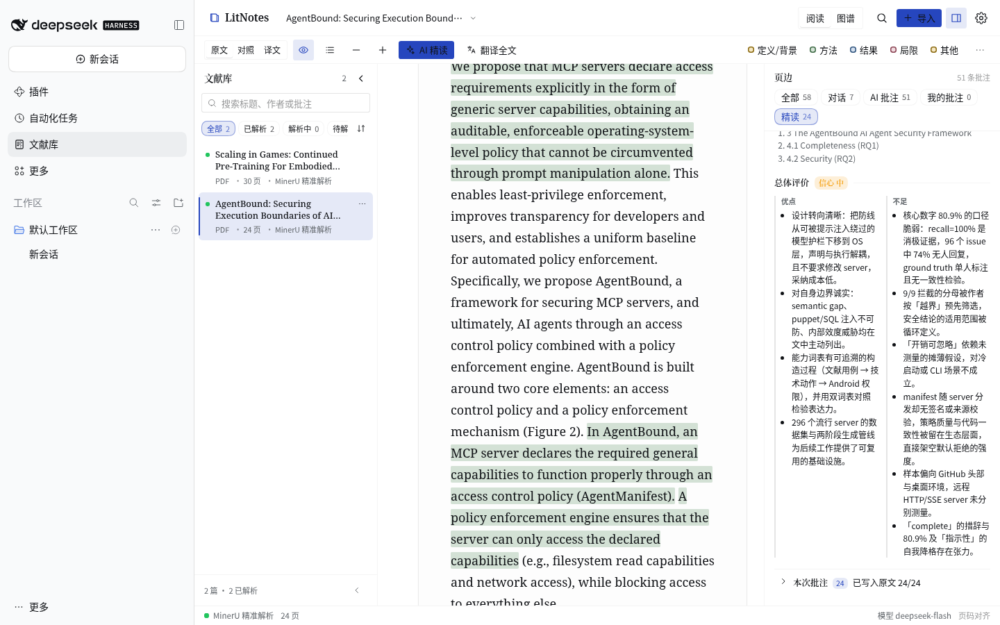 | **精读批注**：跨章节的解释性批注，而不是标题/作者元信息<br>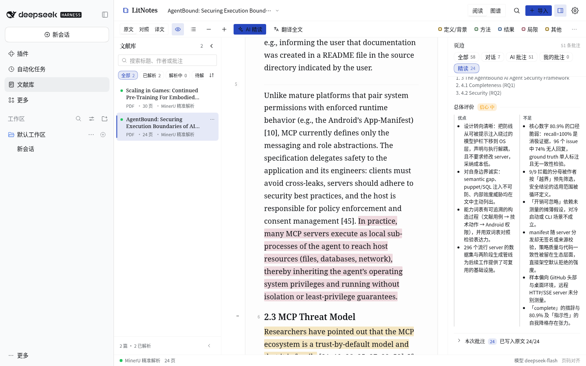 |
| **深色模式 · 阅读**<br>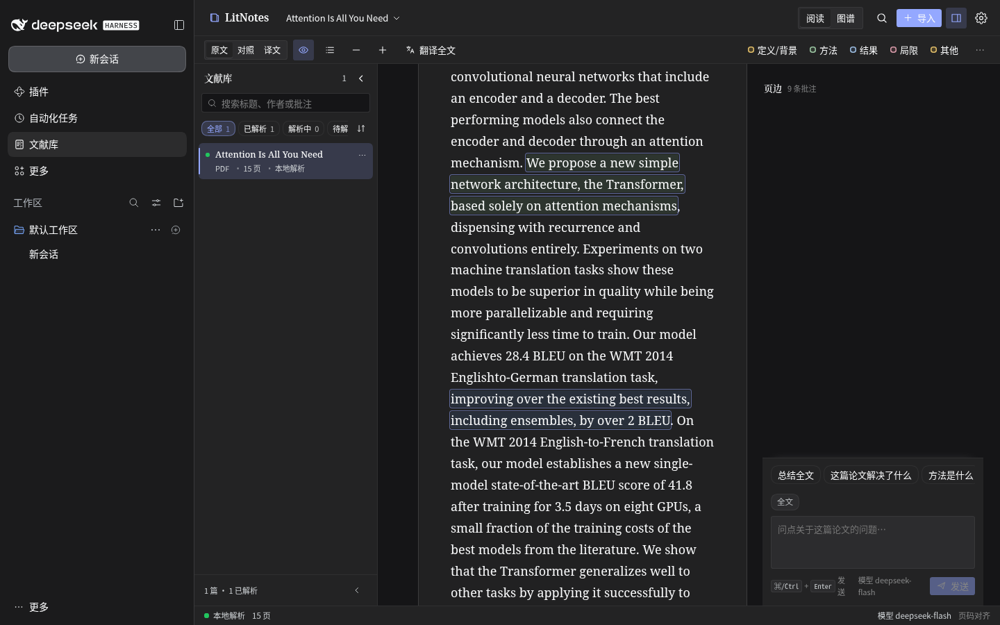 | **深色模式 · 图谱**<br>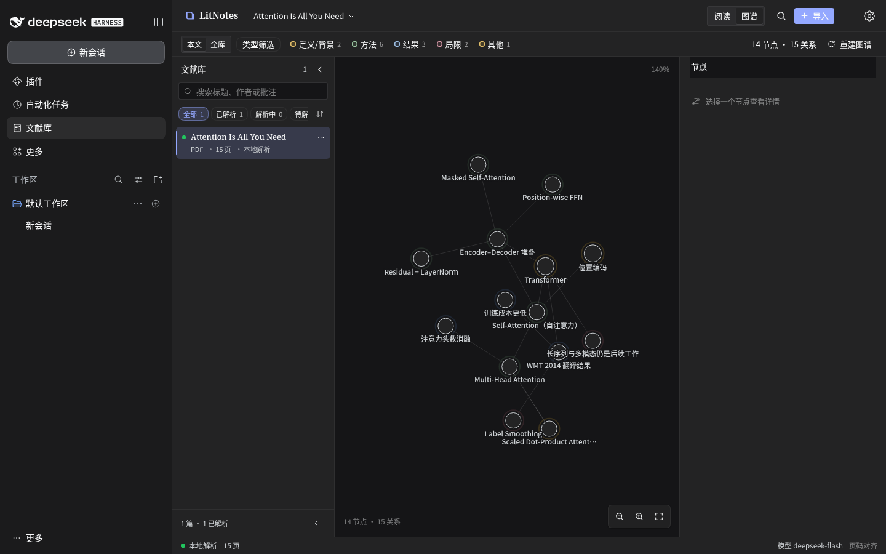 |

## 功能

### 阅读

- 原文 / 双语 / 译文三种模式；正文默认使用纸张全宽，字号、页标记、大纲可调；公式用 KaTeX 本地渲染，图表保持原页顺序。
- 阅读位置、模式、栏宽等偏好保存在本地，重新打开回到上次离开的地方。
- 页边可只显示"我的批注"或"AI 批注"，也可按侧重点筛选。

### 批注与页边

- 四类侧重点（定义/背景、方法、结果、局限/其他）对应四种墨色；高亮、边注与 AI 批注同处一栏。
- 点击高亮弹出批注卡：笔记正文、被引原文，以及**编辑 / 删除**。
- 重新解析后批注按引文自动重锚；无法重锚的标为过期而不是静默丢弃。

### AI 阅读对话

- 回答只基于当前论文的解析文本生成，流式输出；可停止、重新生成、追问。
- 引用先校验后呈现；未证实的引用置灰、不入正文批注。回答附带的引用可一键跳回原文。
- 已验证的引用会自动落成带侧重点颜色的 AI 批注，并记录模型与对话来源。
- 输入框上方常驻一组整篇论文的预设问题（完整对话中也可见），可直接点选。
- 提问默认面向**整篇论文**（不会自动替用户附上某个段落）；段落旁的 **询问 AI 此段** 按钮
  会把焦点收窄到该段，选中文本则收窄到选区——输入框上方的上下文 chip 始终标明当前范围。
- 每篇论文的对话历史保存在本地，可清空、可导出 Markdown。

### AI 精读

- 一键**通读全文、逐节精读**，跨节保留阅读记忆——不是抽样开头加检索命中。
- 生成**大量带证据、可跳转的解释性批注**（默认 24 条，带覆盖率检查），并明确排除标题、作者、
  出处等元信息以及单纯复述引文的批注。
- 生成**结构化的精读报告**：研究问题、研究空白、核心贡献（附证据强度）、方法、实验与证据、
  主要发现、局限与风险、开放问题、论证地图、术语、阅读路径、总体评价；每个要点都能跳回原文
  （`原文 p.N`）。
- 对"读了什么"透明：覆盖章节数、批注数、覆盖率和模型调用次数、耗时、token 都会显示；运行可
  取消、有缓存、可重跑，取消不会丢掉上一份报告与批注。
- 通过 `ai.deepRead*` 配置：调用上限、原文长度、批注数量、单次输出预算、综合摘要长度、
  覆盖率补读与批注校订开关。

### 知识图谱

- **本文图谱**：一键让模型通读论文，抽取概念、方法、发现、定义、局限与章节及它们之间的关系；节点保留原文定位、可跳转，并支持问答持续补充新节点。
- **全库图谱**：对所有论文做确定性聚合，生成主题聚类与共享概念关系，可随时重建。
- 画布支持平移、光标处缩放、拖拽固定；节点可重命名、合并、固定，人工编辑在重建后保留。

### 文献库与解析

- 文献列表保留解析状态与进度，支持搜索、类型筛选、排序；拖拽或链接即可导入。
- 三种解析引擎：MinerU 精准解析（配置 token）、MinerU 轻量云解析（免 token）、本地引擎（不上传，pdf.js 文本抽取）。
- 异步解析队列，支持取消、失败原因、重启续跑与**按页修复**——只重解析坏页并拼回，其余页与批注不受影响。

### Agent 原生

dsh-litnotes 是 DSH 的插件，也把同一套文献库能力开放给 Agent：八个工具、统一的引用坐标，外加一段静态 system prompt 告诉 Agent 何时该用它们。

| 工具 | 作用 |
| --- | --- |
| `library_search` | 全库或单篇检索段落，返回 `documentId/blockKey/page/snippet` |
| `library_read` | 元信息与大纲、按段读 markdown、精确读取某个 block，或整页 |
| `library_ask` | 基于原文的 grounded 回答，附引用坐标（自动生成 AI 批注） |
| `library_deepread` | 读取已保存的精读报告，或立即跑一遍全文精读（较慢、消耗 token） |
| `library_annotate` | 列出 / 新建 / 修改 / 删除高亮与边注 |
| `library_translate` | 翻译任意文本，或最多 10 个带引用的 block |
| `library_graph` | 读取/搜索/构建/更新本文图谱；读取/重建全库图谱 |
| `library_manage` | 列表/状态/URL 导入/解析/按页修复/取消/重命名/删除 |

## 快速开始

### 安装

**从 npm 安装（推荐）**：

```bash
dsh plugin --profile web add dsh-litnotes
```

可固定版本：`dsh plugin --profile web add dsh-litnotes@1.1.0-alpha.2`。

**从 GitHub 安装**：

```bash
dsh plugin --profile web add https://github.com/NIRVANA-APOC/dsh-litnotes
```

或安装预构建包（无需在本地构建）：

```bash
dsh plugin --profile web add https://github.com/NIRVANA-APOC/dsh-litnotes/releases/download/v1.1.0-alpha.2/dsh-litnotes-1.1.0-alpha.2.tgz
```

本地开发时，用 `link:` 指向源码检出目录：

```bash
dsh plugin --profile web add link:/path/to/dsh-litnotes
# 或在 DSH 插件管理器中：plugin_manager install_bundle link:/path/to/dsh-litnotes
```

安装后重新加载 Web UI。前置条件：一个挂载了 `webServer` 与 `connection` 的 DSH Web profile。以下服务按需启用相应能力：`llm`（AI）、`credentials`（持久化 MinerU token）、`translator`（翻译）、`officeToPdf`（Office 本地转换）、`tokenMeter`（上下文预算）、`systemPrompt`（Agent 提示）、`tools`（Agent 工具）。

### 第一次使用

1. 在侧栏打开 **LitNotes 文献库**，拖入或选择一篇 PDF，或粘贴链接导入。
2. 选择解析方式。默认 `auto`：配置了 MinerU token 时使用精准解析；否则优先本地引擎（文件不上传），本地无法处理的格式再回退到免 token 的轻量云解析。
3. 解析完成后打开论文：阅读、对照翻译、高亮与批注，或直接从页边向 AI 提问。
4. 在顶部切换 **阅读 / 图谱**；在图谱中切换 **本文 / 全库**。
5. 在 DSH 对话里让 Agent"检索/阅读/批注文献库"，用的是同一份数据与同一套坐标。

## 数据与隐私

```
~/.dsh/litnotes/                        （或 $DSH_HOME/litnotes）
  documents/<id>/source.<ext>           原始文件
  documents/<id>/parsed/                full.md、content_list.json、图片
  documents/<id>/annotations.json       高亮与页边批注（含 AI 来源）
  documents/<id>/translations.json      逐段翻译缓存
  documents/<id>/chat.json              grounded 对话历史
  documents/<id>/graph.json             本文知识图谱
  library-graph.json                    全库知识图谱
  preferences.json                      阅读与 AI 偏好
```

- 文件、解析结果、批注、对话与图谱都只留在本机；只有在你主动选择云端解析时，源文件才会被上传到 MinerU。
- AI 提问只发送检索到的有界上下文（相关段落），不会上传整库。
- MinerU token 保存在 DSH 的凭据服务中，不会回传给浏览器或写入日志。

## 兼容性

- 磁盘上的 JSON 采用稳定的 version-1 信封，与重构前的 0.3.0 数据格式兼容：既有文献库**无需迁移**直接可用。
- 插件包**零运行时 npm 依赖**；客户端包唯一的运行时外部请求是平台提供的 React 模块。
- 源码为严格 TypeScript（`strict`、`noUncheckedIndexedAccess`、`verbatimModuleSyntax`、无 `any`），Host 与 Client 通过同一份类型化 wire 契约通信。

## 开发

```bash
pnpm install                      # 仅开发依赖
node scripts/build.ts             # 构建 Host index.js 与 Client lib/client.js
pnpm typecheck                    # 严格类型检查
pnpm test                         # vitest（790 个测试）
node scripts/check.ts             # 17 项发布门禁
node scripts/check.ts --final     # 发布门禁（警告视为失败）
```

需要 Node ≥ 20.16。源码分布在 `src/shared/**`（两端共享）、`src/host/**`、`src/client/**`；`index.js` 与 `lib/client.js` 为构建产物。

CI 在 Node 22 与 24 上运行同一套门禁，校验 npm tarball 与已提交的构建产物，并在发布 GitHub Release 时自动发布到 npm——详见 [`docs/RELEASING.md`](docs/RELEASING.md)。

## 文档

| 文档 | 内容 |
| --- | --- |
| [`docs/ARCH.md`](docs/ARCH.md) | 架构、数据格式、HTTP wire 契约、构建与测试门禁 |
| [`docs/PARSING.md`](docs/PARSING.md) | 解析引擎、按页修复、批注重锚 |
| [`docs/AGENT.md`](docs/AGENT.md) | 八个 Agent 工具与完整调用示例 |
| [`docs/AI-SPEC.md`](docs/AI-SPEC.md) | grounded 对话、引用校验、蕴含检查、知识图谱、AI 精读 |
| [`docs/UI-SPEC.md`](docs/UI-SPEC.md) | 阅读台设计系统与交互契约 |
| [`docs/RELEASING.md`](docs/RELEASING.md) | 发布清单、GitHub Actions 与 npm 发布 |
| [`CHANGELOG.md`](CHANGELOG.md) | 版本历史 |

---

Built as a [DeepSeek Harness](https://github.com/deepseek-ai/deepseek-harness) plugin.

[](https://github.com/deepseek-ai/deepseek-harness)
