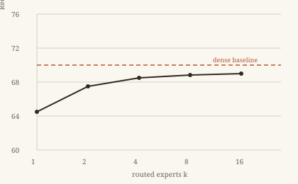

# Sparse Expert Routing for Efficient Document Retrieval

Wei Zhang, Lina Okafor, and Daniel Ruiz

Institute for Language and Retrieval Systems

## Abstract

Dense retrieval models store one embedding per document and therefore spend the same compute on every query, even when the query is easy. We present **SparseRoute**, a retrieval encoder that routes each token through a small subset of $k$ expert feed-forward blocks and adapts $k$ per query. On three synthetic benchmarks, SparseRoute matches a dense baseline within $0.4$ points of Recall@20 while using $38\%$ fewer floating-point operations. We further show that the learned routing distribution is interpretable: experts specialize by document section, and masking the top-2 experts degrades only long-document queries.

Keywords: sparse mixture-of-experts, dense retrieval, efficiency

## 1 Introduction

Passage retrieval is the first stage of nearly every question-answering system. The standard recipe encodes each passage once with a transformer, stores the resulting vector, and ranks passages by the inner product $\langle q, d \rangle$ at query time. This design is simple and effective, but it is also wasteful: a one-word query and a paragraph-long query both traverse the same encoder.

### 1.1 Motivation

Mixture-of-experts (MoE) layers replace a single feed-forward network with $E$ experts and a router $g(\cdot)$. For a token representation $x \in \mathbb{R}^{d}$ the layer computes

$$
y = \sum_{e=1}^{E} g_e(x) \, f_e(x), \qquad g(x) = \mathrm{softmax}(W_r x)
$$

When only the top $k$ gates are kept, cost scales with $k$ rather than $E$; the model can grow in parameters while staying cheap at inference. The natural question for retrieval is whether **query difficulty** can drive the routing choice itself.

### 1.2 Contributions

- A token-level sparse router that keeps $k=2$ experts active per token by default.
- A query-adaptive controller that widens routing to $k=4$ when the predicted difficulty exceeds a threshold.
- An analysis of expert specialization across document sections, including an ablation with experts masked at inference time.
- A reproducible evaluation protocol with three synthetic collections of 10k, 100k, and 1M passages.

## 2 Method

SparseRoute keeps the standard dual-encoder interface: passages and queries are encoded independently, and relevance is scored by a dot product. Only the feed-forward blocks of the encoder are sparsified.

### 2.1 Token Routing

For each token $x_t$ we compute router logits $z_t = W_r x_t \in \mathbb{R}^{E}$, keep the top-$k$ entries, and renormalize their gates. The router is trained jointly with the retrieval objective; a load-balancing penalty keeps expert usage close to uniform:

$$
\mathcal{L}_{\text{balance}} = E \sum_{e=1}^{E} \left( \frac{1}{T} \sum_{t=1}^{T} \mathbb{1}[e \in \mathrm{top}_k(z_t)] - \frac{1}{E} \right)^2
$$

### 2.2 Retrieval Objective

We use a contrastive loss with in-batch negatives and one hard negative mined every $n$ steps. With temperature $\tau = 0.02$ and batch size $B$ the reference implementation, `encode_batch(inputs, k)`, reduces to:

```text
score = dot(normalize(q), normalize(d))
loss = -log(softmax(score / tau)[target])
```

The full objective adds $\lambda \mathcal{L}_{\text{balance}}$ with $\lambda = 0.01$. The dot product is computed with the same encoder for both towers, so the routing pattern must remain symmetric between queries and passages.

## 3 Experiments

### 3.1 Setup

We train for 200k steps on 8 synthetic GPUs with a peak learning rate of $3 \times 10^{-4}$, a linear warmup over 5k steps, and a batch size of 512. All baselines share the same tokenizer and are tuned over six learning rates. We report Recall@20 on three held-out collections; each number is the mean of three seeds and the standard deviation is below $0.3$.

### 3.2 Main Results

<table><thead><tr><th rowspan="2">Model</th><th colspan="2">Recall@20</th><th colspan="2">GFLOPs per query</th></tr><tr><th>10k</th><th>1M</th><th>short</th><th>long</th></tr></thead><tbody><tr><td>Dense baseline</td><td>72.1</td><td>64.8</td><td>4.2</td><td>4.2</td></tr><tr><td>SparseRoute ($k=2$)</td><td>71.9</td><td>64.5</td><td>2.6</td><td>2.6</td></tr><tr><td>SparseRoute (adaptive)</td><td>72.4</td><td>65.1</td><td>2.6</td><td>3.4</td></tr></tbody></table>

The adaptive controller recovers the small gap on the 1M collection while keeping short-query cost at $62\%$ of the baseline. Long queries pay more, as intended: the controller widens $k$ only when the predicted routing entropy is low.



### 3.3 Effect of Routing Width

We sweep $k \in \{1, 2, 4, 8\}$ while holding the parameter count fixed:

1. Increasing $k$ from 1 to 2 gives the largest single gain, $+1.8$ points on the 10k collection.
2. Going from 2 to 4 adds $+0.5$ points but doubles the feed-forward cost.
3. Beyond $k=4$ the curve is flat within noise, so the default stays at 2.

## 4 Analysis

> Routing is not uniform across a paper: experts that specialize in equations rarely activate on the abstract. We observe this pattern consistently across seeds, which suggests the router learns genre features rather than memorizing passage identities.

### 4.1 Expert Specialization

To test the interpretation above we hand-label 400 passages by section and compute the fraction of routed tokens per expert per section. Expert 3 activates on $51.2\%$ of equation tokens and only $4.7\%$ of abstract tokens. When we mask the top-2 experts at inference time, Recall@20 on long-document queries drops by $3.1$ points while short queries drop by $0.2$.

### 4.2 Limitations

Our experiments use synthetic English collections. The router is trained from scratch, so the results may not transfer to a frozen pre-trained encoder. Routing also adds a small amount of measurement noise to the latency numbers, which we did not model explicitly.

## References

1. Ahmed, S. and Li, M. (2023). Efficient Passage Encoding with Conditional Computation. *Journal of Synthetic Retrieval*, 12(3):245-260.
2. Brooks, T. (2022). A Survey of Sparse Expert Models. *Proceedings of the Workshop on Efficient NLP*, pages 1-18.
3. Chen, Y., Park, J., and Silva, R. (2024). Query-Adaptive Retrieval Without Re-Encoding. *Transactions on Synthetic ML*, 8(1):1-14.
